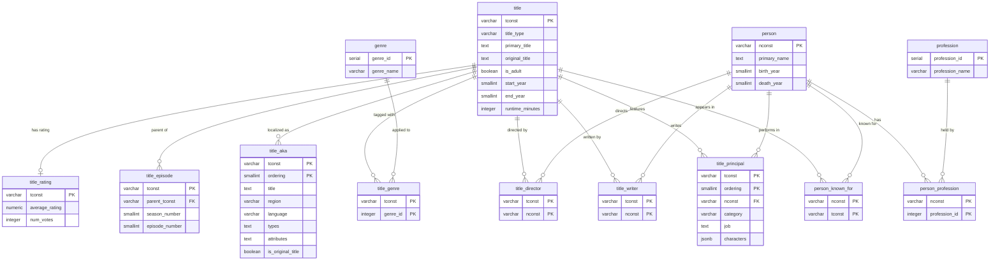

# IMDb Database — Entity Relationship Diagram

This diagram shows the 13 tables in the `core` schema and the relationships between them. Crow's-foot notation: `||--o{` means "one to zero or many."

